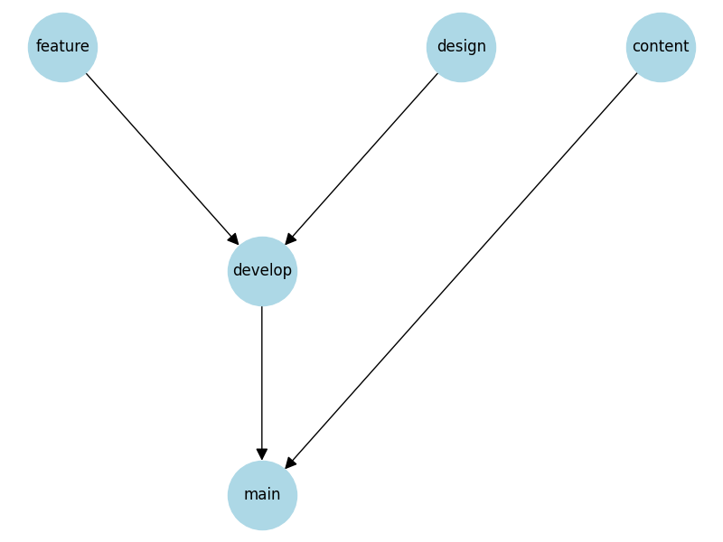
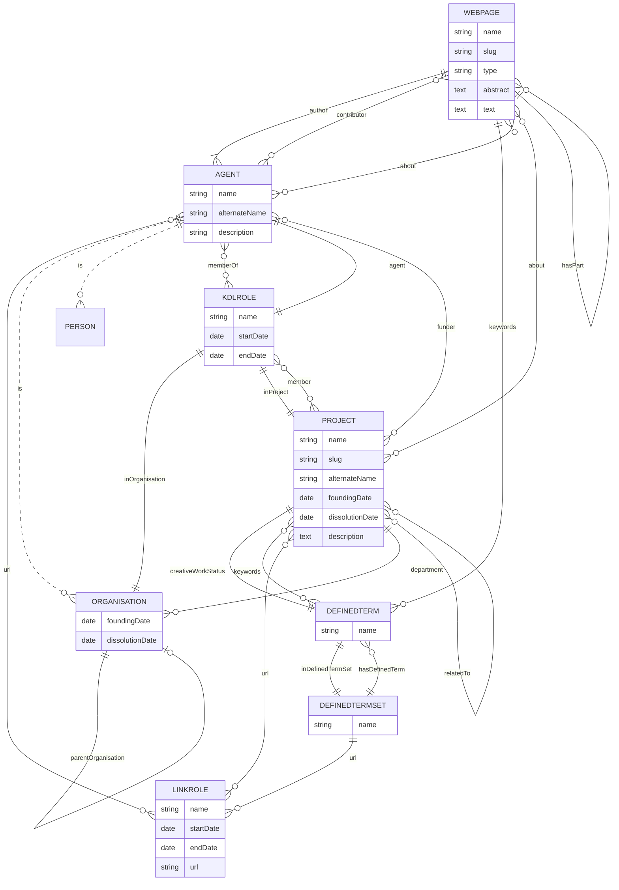

# KDL Web Project

[](https://github.com/kingsdigitallab/kdl/actions/workflows/frontend.yml)
[](https://github.com/kingsdigitallab/kdl/actions/workflows/pages/pages-build-deployment)

## URLs

- [dev site:](https://kingsdigitallab.github.io/kdl/)

```text
https://kingsdigitallab.github.io/kdl/
```

- [live site:](https://kdl.kcl.ac.uk/)

```text
https://kdl.kcl.ac.uk/
```

## Architecture

This project is set up as a monorepo with PNPM workspaces. The website uses a static-first approach.

### Modules

This project is set up as a monorepo with:

#### Apps

- **[ETL](./apps/etl/readme.md)**: Fetches data from ClickUp transforms it to markdown files and JSON project index.
- **[Frontend](./apps/frontend/readme.md)**: Eleventy static site generator

#### Docs

Docs contains all the available content that get served by the frontend.

#### Packages

- **KDL components**: Nunjucks components

## Set up

### Dependencies

- [PNPM](https://pnpm.io/installation)
- [Node LTS](https://nodejs.org/)

> [!NOTE]
> It is recommended to [install Node](https://pnpm.io/cli/runtime#examples) with PNPM.

Clone the repo:

```bash
git clone git@github.com:kingsdigitallab/kdl.git
```

Install:

```bash
pnpm install
```

Run:

```bash
pnpm run dev
```

## Contributing

### Content updates

TBA

### Dev

#### Merge strategy



#### Data model

The data model is based on the [schema.org](https://schema.org/) vocabulary. Local customisations are prefixed with `KDL`.


